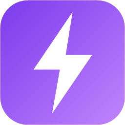
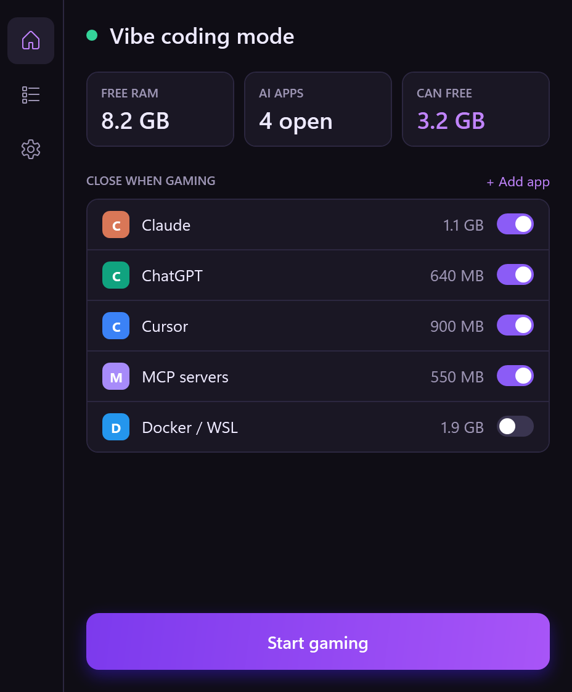
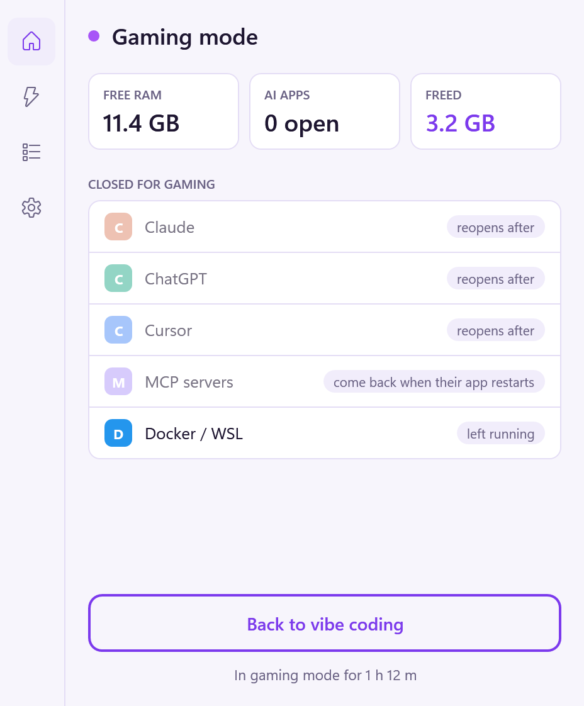

<p align="center"></p>

<h1 align="center">VibeShift</h1>

<p align="center"><b>One click from vibe coding to gaming, and back.</b></p>

<p align="center">
  
  &nbsp;
  
</p>

If you build with AI tools on the same Windows PC you game on, you've probably had this happen: you launch a game and it stutters. Claude, ChatGPT, Cursor, a local model, a handful of MCP servers and maybe Docker or WSL are still running in the background, holding several gigabytes of RAM between them.

VibeShift closes the ones you choose in one click and shows how much memory you got back. When you're done playing, one more click reopens everything it closed.

## Download

1. Download **VibeShift.exe** from the [latest release](https://github.com/bth0mp/VibeShift/releases/latest).
2. Run it. There's no installer, and you don't need to install anything else. Windows 10 or 11, 64-bit.

The first time you run it, Windows may show **"Windows protected your PC"**. Click **More info**, then **Run anyway**. This appears because the app isn't code-signed, which costs money every year. All the source code is in this repo, and you can build the exe yourself (see [Build from source](#build-from-source)).

## How it works

**Start gaming**

1. Asks each app you've switched on to close. Anything still open after 5 seconds (you can change this) is force-closed.
2. Stops leftover MCP servers.
3. Shuts down WSL and Docker, if you've switched them on.
4. Pauses a couple of Windows background services, if you've turned on [Extra boost](#extra-boost).
5. Shows how much RAM was freed.

**Back to vibe coding**

- Reopens only the apps VibeShift closed, in the order it closed them. Apps that are already running again are skipped.
- Microsoft Store apps (like Claude and ChatGPT) reopen through Windows, the same way the Start menu opens them.
- If VibeShift crashes or your PC restarts in the middle of a game, it opens in gaming mode next time, so **Back to vibe coding** still knows what to reopen.

Closing the window keeps VibeShift running as a small icon by the clock. Right-click that icon to switch modes or quit.

## What it can close

| App | Switched on by default | Reopened afterwards |
|---|---|---|
| Claude (desktop) | Yes | Yes |
| ChatGPT (desktop) | Yes | Yes |
| Cursor | Yes | Yes |
| Windsurf | Yes | Yes |
| Microsoft Copilot | Yes | Yes |
| Microsoft 365 Copilot | Yes | Yes |
| Ollama | Yes | Yes |
| LM Studio | Yes | Yes |
| MCP servers | Yes | They come back when their app restarts |
| VS Code | No | Yes |
| Docker / WSL | No | Docker Desktop yes. WSL starts again by itself the next time something uses it |
| Command-line AI agents (Claude Code, Codex CLI, Gemini CLI, including npm installs) | No | No. Closing one ends what it was doing, and it can't be reopened inside your terminal |

- **When apps show up.** An app appears in VibeShift once it has seen it running. Use **+ Add app** to add any other program.
- **MCP servers.** VibeShift spots these by their command line (`mcp`, `modelcontextprotocol`, `desktop-commander`). Other Node or Python processes, such as language servers, dev servers and your own scripts, are left alone. With the MCP row switched on, every MCP server stops, including ones used by apps you keep open. Those apps get their tools back when they restart.
- **What it never closes.** Windows' own processes, the game you're playing (or anything it started), and VibeShift itself.
- **Separate apps stay open.** A browser opened from a link in Claude, or an app whose row you switched off, survives even if a closed app started it.
- **Started VibeShift from an app's terminal?** Then that app is left running, since VibeShift can't close part of it and reopen it afterwards.

## Auto mode

Off by default. Turn it on in Settings and VibeShift switches to gaming mode by itself when a game starts. It switches back 10 seconds after the game closes, so a launcher restarting the game doesn't bounce your apps.

**What counts as a game:**
- Any program with a window running from a Steam, Epic, GOG, EA app or Xbox app games folder. VibeShift finds those folders automatically.
- Anything you add under **My games**.
- Launchers, crash reporters, anti-cheat services, installers and non-game Steam apps such as Wallpaper Engine are ignored.

**Your clicks always win:**
- Switch back to vibe coding by hand while a game is still running, and Auto mode leaves that game alone.
- Start gaming by hand, and Auto mode won't switch you back.

Automatic switches never open the VibeShift window or pop anything up over your game.

## Extra boost

Off by default. When it's on, **Start gaming** also pauses two Windows background services: SysMain (memory prefetching) and Windows Search indexing. **Back to vibe coding** restarts them. Pausing and restarting services needs admin permission, so Windows asks when you click Start gaming and again when you switch back. Auto mode skips this step so nothing pops up mid-game.

## Privacy and permissions

- VibeShift never connects to the internet. No telemetry, no accounts, no update checks.
- It runs as a normal app, without admin rights. Only Extra boost asks for admin, and only when you click.
- Its files live in `%APPDATA%\VibeShift`:
  - `settings.json`: your choices.
  - `session.json`: what to reopen. It only exists while you're in gaming mode.
  - `vibeshift.log`: a short log, handy if you open an issue.

## Build from source

You need the [.NET 10 SDK](https://dotnet.microsoft.com/download).

```
dotnet test
dotnet publish src/VibeShift -c Release -r win-x64 --self-contained -p:PublishSingleFile=true -p:IncludeNativeLibrariesForSelfExtract=true -o publish
```

The exe ends up in `publish\VibeShift.exe`. It isn't compressed on purpose: a compressed single-file build is half the download but uses about twice the RAM, and saving RAM is the point.

## License

[MIT](LICENSE)
